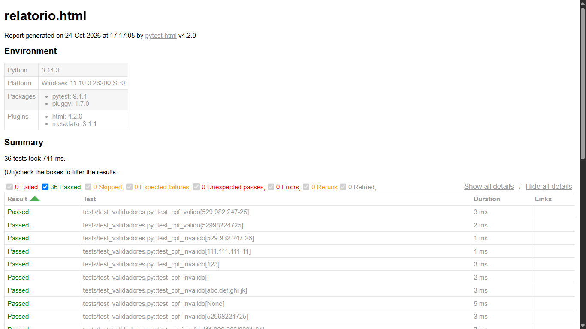

# Validador de Dados (Python + Pytest)

Funções para validar CPF, CNPJ, e-mail e telefone brasileiro, com testes automatizados.

## Como rodar
```bash
pip install -r requirements.txt
pytest -v
pytest --html=relatorio.html --self-contained-html
```

## O que é testado
- Casos válidos (com e sem máscara)
- Casos inválidos (dígito errado, sequências repetidas, tamanho errado)
- Entradas vazias e tipos inesperados (None, número)

## Próximos passos
- Integrar com GitHub Actions
- Adicionar validação de CEP e placa de veículo

## Resultado dos testes


